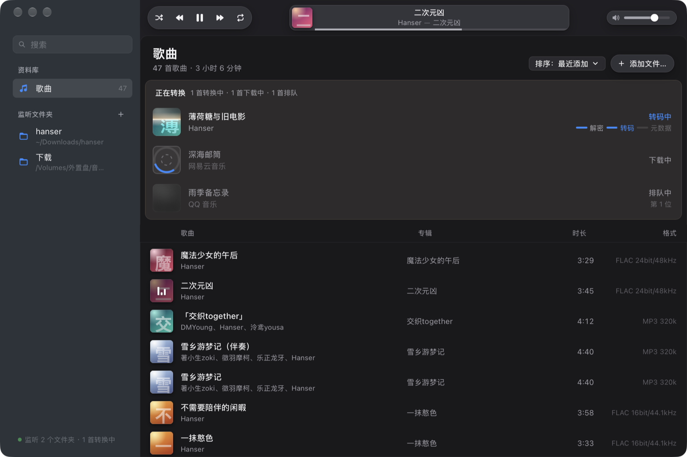
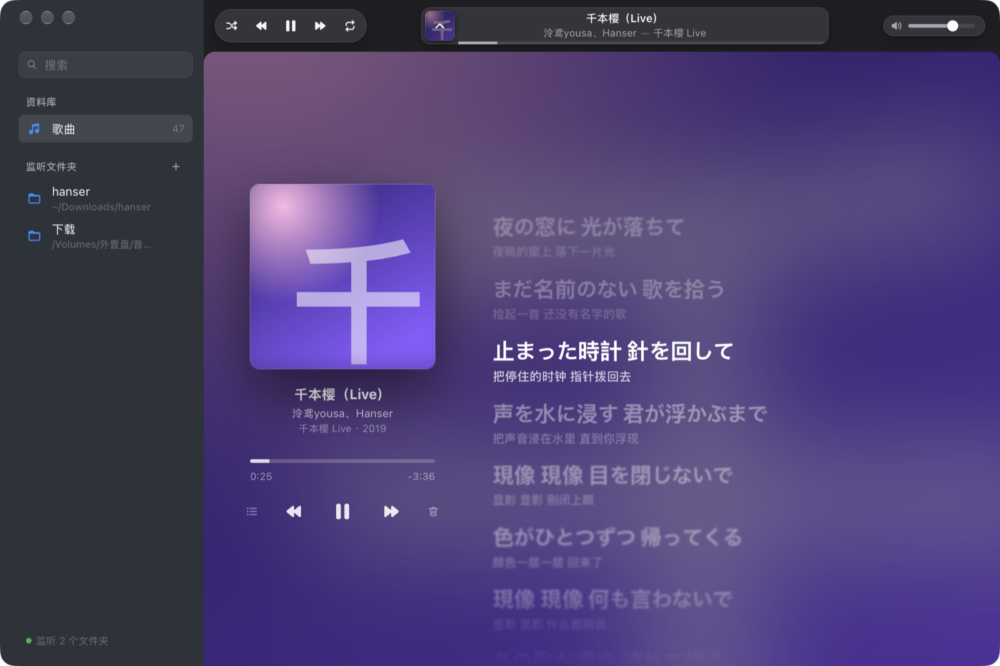

# musicReveal

[](https://github.com/TL-Yao/musicReveal/actions/workflows/ci.yml)
[](LICENSE)

[English](README.md) | 简体中文

musicReveal 是一个 macOS 上的小型音乐播放器，自带解密能力：监听你指定的文件夹，把 QQ 音乐、网易云音乐下载的加密音乐在本机转换成普通音频文件，补全封面、歌词等元数据，收进资料库直接播放。





## 功能

### 支持的格式

| 来源 | 格式 | 说明 |
| --- | --- | --- |
| QQ 音乐（新版） | `mflac`、`mgg` 等 musicex 格式 | 需要本机已安装并登录 QQ 音乐 |
| QQ 音乐（旧版） | `qmcflac`、`qmcogg`、`qmc0`/`qmc2`/`qmc3`、`bkc*`，以及文件内自带密钥的 `mflac`/`mgg` | 仅用合成样本测试，并与参考实现逐字节交叉核对；未用真实文件验证 |
| 网易云音乐 | `ncm` | 无需登录 |
| 普通音频 | `mp3`、`flac`、`ogg`、`m4a`、`wav` | 同样复制进输出目录、按规则命名并补全元数据；网易云下载的普通文件按文件内记录的歌曲 ID 补全 |

### 输出

- **原格式**：保持解密后的格式（FLAC、OGG、M4A、MP3 等）。例外：APE 与 WMA 无法可靠写入完整标签，APE 转为 FLAC（无损到无损），WMA 转为 320 kbps MP3。
- **Apple Music 兼容**：转成 Apple Music / iPhone 能直接播放的格式，由应用内置的 ffmpeg 完成，无需另行安装。FLAC、WAV、APE 转为 ALAC（`.m4a`，无损，位深与采样率不变）；OGG、Opus、WMA 转为 256 kbps AAC（`.m4a`）；MP3 与 M4A 原样保留、不重新编码。转换时保留全部标签、封面和歌词。
- 在设置里切换这一项时，输出目录里已有的无损歌曲会跟着转（打开时 FLAC/WAV → ALAC，关闭时 ALAC → FLAC），切换前会告诉你有多少首、大约要多久。一首一首地转：先在同一文件夹写隐藏副本，核对声音逐采样一致、标签封面歌词都没丢，才换上并删掉旧文件；文件创建时间不变；同名文件不覆盖。转换期间可以照常播放，退出应用会中断，下次打开接着转。
- 宁可不转，也不丢信息：只转本应用自己写得出的那种文件。带自定义标签字段、多值或空值标签、带歌词的 WAV、多于两声道、32 bit 或浮点、多张图片或非正面封面、只读文件，都不会跟着转，原样留在输出目录里照常播放。

### 元数据补全

保留文件自带的标签，再按文件内的歌曲 ID 向对应平台查询，补全年份、曲序、碟号、专辑艺人、高清封面和歌词（含翻译）。多位歌手全部保留。歌词以带时间标的 LRC 嵌入音乐文件，同时在输出目录的 `lrc` 文件夹里按相同子路径生成同名 `.lrc`。普通音频旁边的同名 `.lrc` 也一并收进来。网易云歌词开头的 JSON 署名行会改写成普通歌词行。

### 自动监听

应用运行期间（关掉窗口也算），监听文件夹里新下载完成的歌曲自动转换；应用退出期间下载的，下次打开时自动补转。也可以把文件拖进窗口或用「添加文件…」手动转换。输出目录本身永远不会被当作来源。

### 资料库与播放

资料库就是输出目录（含子文件夹）里实际存在的全部可播放文件，包括你手动放进去的。

- 播放/暂停、上一首/下一首、拖动进度、音量、随机、循环、搜索与排序。
- 播放队列可查看、点选跳转。
- 歌词页：滚动歌词（含翻译），优先读内嵌的带时间歌词，没有时退回同名 `.lrc`；扫描时会给没有内嵌歌词但找得到 `.lrc` 的歌补嵌，并把歌曲旁边的 `.lrc` 挪进 `lrc` 文件夹。
- 键盘媒体键与控制中心「正在播放」可控制播放。
- 右键可在 Finder 中显示，或移到废纸篓（连同它的 `.lrc`）；⌘⌫ 把当前曲移到废纸篓，⌘Z 撤回。

### 不改动源文件

转换结果写入输出目录（默认 `~/Music/musicReveal`），文件命名为「歌手 - 歌名」（多位歌手以「、」分隔）；同名文件自动加编号，不覆盖；已转换过的歌曲自动跳过（内容完全相同、只是换了文件名或位置的也会跳过）。

## 系统要求

macOS 11 及以上，Apple Silicon（arm64）。只在 Apple Silicon Mac 上测试过；Intel Mac 与 Windows 未测试，不承诺支持。

## 安装与首次打开

1. 打开 `musicReveal_<版本>_aarch64.dmg`，把 musicReveal 拖到「应用程序」文件夹。
2. 首次打开需要手动允许一次。

musicReveal 使用开发者自己生成的固定证书签名，没有经过 Apple 公证。签名本身完整有效（`codesign --verify` 通过，应用内容被改动后签名即失效），但证书不来自 Apple，Gatekeeper 不认可它，从网上下载的安装包第一次打开会被拦下：

- **macOS 14 及更早**：在「应用程序」里按住 Control 键点按 musicReveal，选「打开」，在对话框中再点「打开」。
- **macOS 15 及更新**：先双击打开一次，看到拦截提示后点「完成」；进入「系统设置 → 隐私与安全性」，在页面下方找到关于 musicReveal 的提示，点「仍要打开」，输入登录密码确认。

允许一次之后不再提示。证书固定不变，升级到同一证书签名的新版本后，已给过的授权仍然有效。自己从源码构建的应用没有「来自网络」的标记，直接打开即可。

## 使用

1. 首次打开时，添加要监听的文件夹（也可以之后在侧栏随时添加）。
2. 确认输出目录和输出格式（原格式或 Apple Music 兼容），之后可在设置中随时修改。
3. 如果新加的文件夹里已有未转换的歌曲，应用会问一次是否转换它们；否则只处理以后新下载的文件。
4. 之后在 QQ 音乐或网易云音乐下载歌曲，下载完成后会出现在资料库上方的「正在转换」中，转换完成即进入资料库。

关闭窗口不会退出：播放与转换照常进行，点 Dock 图标重新打开窗口。按 ⌘Q 退出；正在转换的歌曲会中断并删除未完成的文件，下次打开时自动重新转换。设置在菜单「musicReveal → 设置…」（⌘,）。

## 隐私

- 解密、转码、写标签全部在本机完成，音频文件不会上传到任何地方。
- 联网只用于补全元数据：按歌曲 ID 向 QQ 音乐、网易云音乐的公开接口查询歌曲信息、封面和歌词，不做模糊搜索，不发送音频内容。
- QQ 音乐新版格式的解密密钥需要向 QQ 音乐的接口获取，为此会读取本机 QQ 音乐客户端保存的登录信息。这些信息只在本机用于这一请求，不保存到别处，不上传给第三方。界面上显示的账号是打码后的。
- 网易云音乐的文件不需要任何登录信息。

## 常见问题

**「正在转换」中的歌曲显示「待登录」**
这是 QQ 音乐新版格式的文件，解密需要 QQ 音乐的登录信息，而本机 QQ 音乐尚未登录或登录已过期。打开 QQ 音乐并登录后，这些歌曲会自动继续转换。

**QQ 音乐状态显示「需要授权」**
旧版 QQ 音乐把登录信息保存在受系统保护的位置，读取前需要你授权一次：点 QQ 音乐状态旁的「授权…」，在「隐私与安全性 → 完全磁盘访问权限」中打开 musicReveal 的开关，然后重新打开 musicReveal。把 QQ 音乐更新到最新版本后不再需要这项授权。

**转换失败，原因是「文件不完整」**
文件仍在下载，或下载中断导致文件被截断。等下载完成后点「重试」；如果文件本身已损坏，请在原平台重新下载。

**转换格式时提示缺少 ffmpeg**
正式打包的应用内置了 ffmpeg。如果你运行的是用 `cargo` 或 `npx tauri dev` 启动的开发版本，需要自行安装 ffmpeg（例如 `brew install ffmpeg`），或用环境变量 `REVEAL_FFMPEG` 指定其路径。

## 从源码构建

需要：Xcode 命令行工具、Rust stable、Node.js 22，以及用于汇总依赖许可的 `cargo-about`（`cargo install --locked cargo-about`）。

```sh
# 以下命令都在仓库根目录执行

# 开发运行
(cd app && npm ci && npx tauri dev)

# 检查与测试
cargo fmt --all --check
cargo clippy --workspace --all-targets -- -D warnings
cargo test --workspace
(cd app && npx tsc --noEmit && npx vite build)

# 打包：产出 dist/musicReveal.app、dist/musicReveal_<版本>_aarch64.dmg
# 与 dist/musicReveal_<版本>_ffmpeg-lame-source.tar
scripts/package.sh
```

`scripts/package.sh` 依次完成：编译内置 ffmpeg、生成 Rust 依赖许可清单、`tauri build`、签名、用 `hdiutil` 生成 `.dmg`，最后把内置 ffmpeg 对应的源码打成 `_ffmpeg-lame-source.tar`。可以重复运行。

- **内置 ffmpeg**：`scripts/build-ffmpeg.sh` 从官方地址下载 FFmpeg 与 LAME 源码，校验 SHA-256 后编译一个只含转码所需组件的 LGPL 版本（arm64，macOS 11+，不依赖 Homebrew），结果缓存在 `build/ffmpeg/`；脚本内容变了会自动重新编译，传 `--force` 可强制重新编译。
- **签名**：`scripts/sign-local.sh` 第一次运行时用 openssl 生成自签名代码签名证书「musicReveal Local Signing」（有效期 10 年），保存在独立的钥匙串 `~/Library/Keychains/musicreveal-signing.keychain-db`，钥匙串密码保存在同目录的 `musicreveal-signing.password`（权限 600）。它不改动登录钥匙串、搜索列表或系统信任设置，全程没有弹窗。删除这两个文件会生成新证书，已给过的系统授权需要重新授予。

### 仓库结构

| 路径 | 内容 |
| --- | --- |
| `crates/reveal-core` | 核心库：格式识别、解密、元数据补全、转码、资料库 |
| `app/src-tauri` | Tauri 后端：监听、转换队列、播放器、系统集成 |
| `app/src` | 前端（TypeScript，无框架） |
| `scripts/` | 打包、内置 ffmpeg 构建、本机签名、许可清单生成 |
| `tools/crosscheck` | 开发工具：用合成样本与参考实现逐字节交叉核对解密输出 |

### 测试

标记为 `#[ignore]` 的测试需要联网或本机真实文件，默认不运行。真实样本（QQ 音乐 `.mflac`、网易云 `.ncm` 与带 163 key 的 `.mp3`）放在 `testdata/real-samples/`，是版权音乐，已列入 `.gitignore`、永不入库；可用 `REVEAL_NCM_DIR` / `REVEAL_E2E_DIR` 指定别处。测试只把样本复制到临时目录再用；解密 `.mflac` 的端到端测试另外只读本机的 QQ 音乐登录信息。

发版前整套测试要对着随包的精简 ffmpeg 再跑一遍，开发机上完整的 ffmpeg 会遮住随包版缺的组件：

```sh
scripts/package.sh
REVEAL_FFMPEG=$PWD/dist/musicReveal.app/Contents/MacOS/ffmpeg \
REVEAL_GEN_FFMPEG=/opt/homebrew/bin/ffmpeg \
cargo test --workspace -- --include-ignored
```

### 发布

发布时必须把 `dist/musicReveal_<版本>_ffmpeg-lame-source.tar` 与 `.dmg` 一起上传到同一个发布页。应用内置的 ffmpeg 以 LGPL 授权，这个 tar 是它的对应源码，按 LGPL 须与二进制在同一处提供；只上传 dmg 不符合许可要求。

## 许可

musicReveal 以 [MIT 许可](LICENSE) 发布。第三方组件与参考实现的许可见 [THIRD_PARTY_NOTICES.md](THIRD_PARTY_NOTICES.md)。

musicReveal 仅用于转换你本人合法获得的音乐文件，请遵守所在地的法律和各音乐平台的服务条款。
